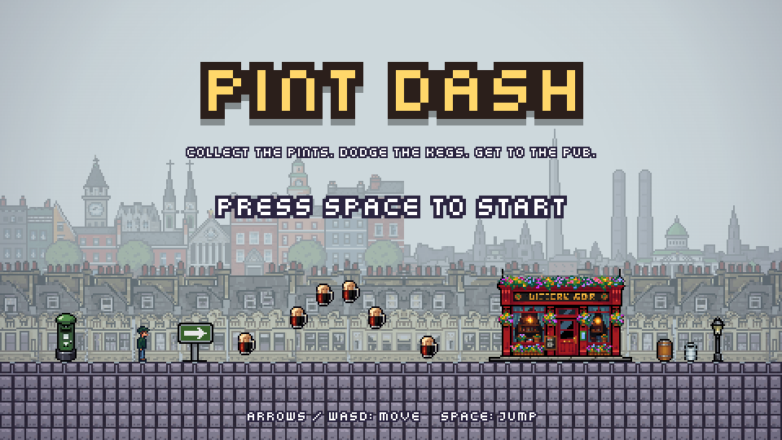
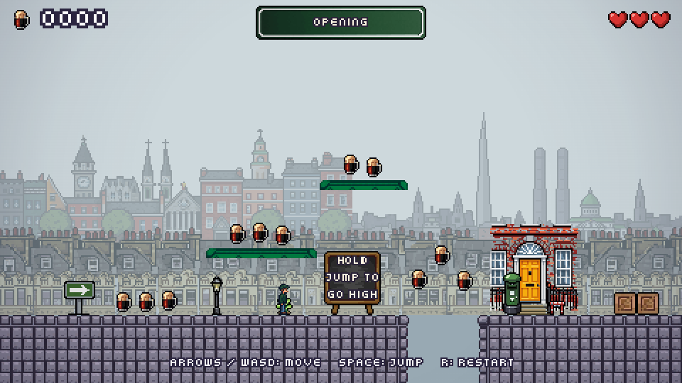
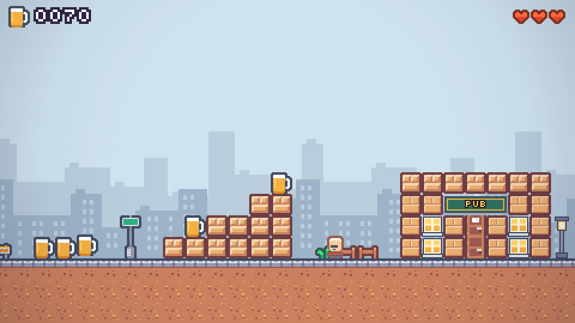
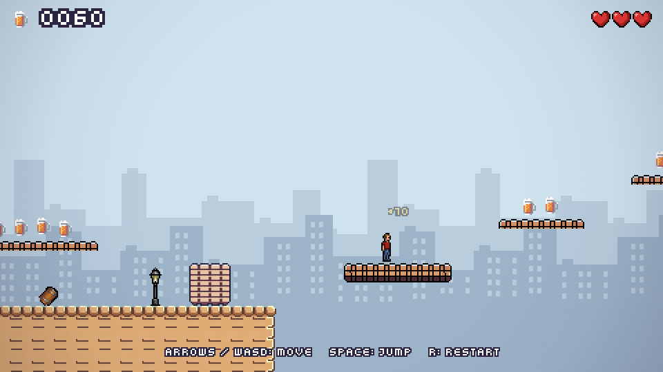
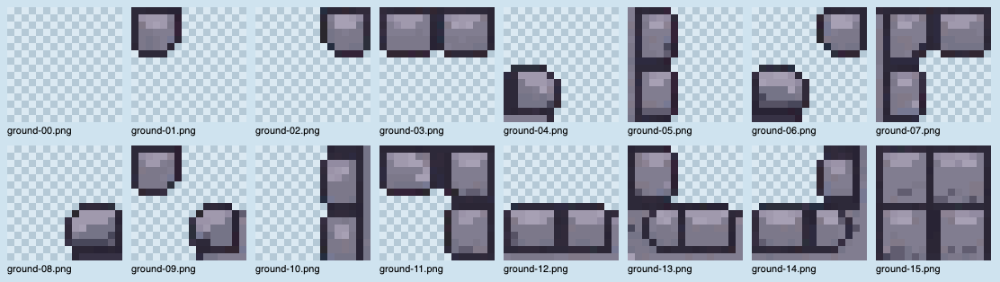
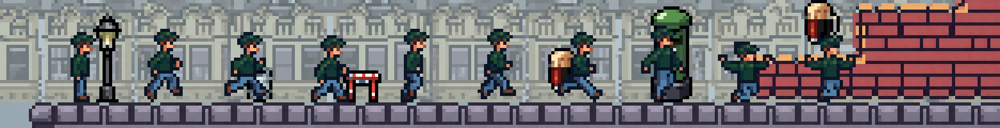
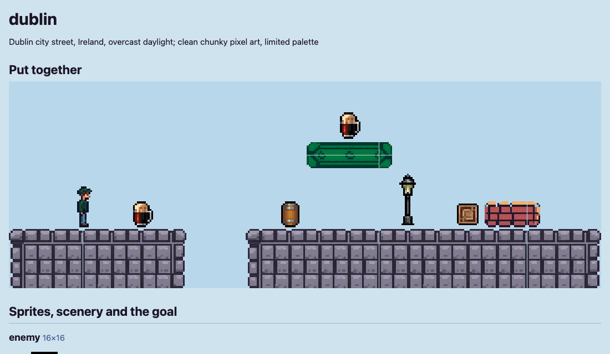
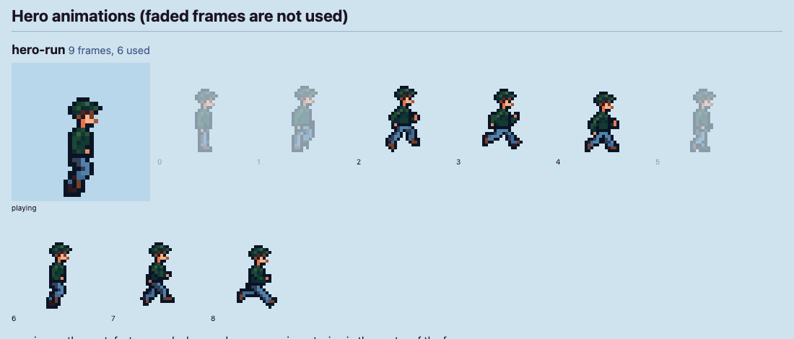

> **These are Pint Dash's own README, as written on 4 October 2026.** Pint Dash was the whole of this repo
> then; it now lives in `src/games/pint-dash`, and every path below (`src/...`, `tools/art/...`,
> `docs/images/...`) is inside that folder. PubPixels' platformer grew out of it and has left it
> behind. For making a new game, read `README.md` and `CLAUDE.md` at the top of the repo instead.

# Pint Dash



A small pixel-art platformer set on a Dublin street: collect the pints, dodge the rolling
kegs, get to the pub. It is built with [Phaser 4](https://phaser.io), TypeScript and Vite.
(The repository and npm package keep the working name `phaseplay`.)

It is a playable vertical slice: a title screen and one level of about a minute and a
half, in eight sections that get harder as they go. Three things about it are unusual,
and most of this document is about them:

1. **The art is swappable.** The level, the physics and the rules never mention a picture.
   A _theme_ supplies every image and decides how the level is drawn, so the same game
   runs with three different looks.
2. **A theme's art can be generated from a description in words.** A script sends that
   description to an image service piece by piece and writes a pack the game loads
   without any code change. The Dublin look was made this way for about 20 US cents.
3. **The tests play the level.** A small copy of the game's physics tries every jump from
   every place the player can stand, so `npm test` fails if the pub, a checkpoint or a
   single pint cannot be reached, and reports the quickest possible time.

## Contents

- [Quick start](#quick-start)
- [How the game is built](#how-the-game-is-built)
  - [Stack](#stack)
  - [Folder map](#folder-map)
  - [Scenes and start-up](#scenes-and-start-up)
  - [One frame of play](#one-frame-of-play)
  - [The rules that hold it together](#the-rules-that-hold-it-together)
  - [The level](#the-level)
  - [Proving the level can be played](#proving-the-level-can-be-played)
  - [Movement](#movement)
  - [Input and touch](#input-and-touch)
  - [Themes](#themes)
  - [How a generated pack is drawn](#how-a-generated-pack-is-drawn)
  - [Tests and checks](#tests-and-checks)
- [Generating a theme](#generating-a-theme)
  - [The pipeline at a glance](#the-pipeline-at-a-glance)
  - [What you need](#what-you-need)
  - [Walkthrough: a new theme from scratch](#walkthrough-a-new-theme-from-scratch)
  - [The theme description, field by field](#the-theme-description-field-by-field)
  - [What is sent for each piece](#what-is-sent-for-each-piece)
  - [Prompting guide](#prompting-guide)
  - [What went wrong, and the fix](#what-went-wrong-and-the-fix)
  - [How the generator is built](#how-the-generator-is-built)
  - [The pack format](#the-pack-format)
  - [What it costs](#what-it-costs)
  - [Limits and rough edges](#limits-and-rough-edges)
  - [Checklist for a new theme](#checklist-for-a-new-theme)
- [Credits and licences](#credits-and-licences)

---

## Quick start

Requirements: Node 22.12 or newer (the repo pins Node 24 in `mise.toml`; with
[mise](https://mise.jdx.dev) installed, `mise install` sets it up) and npm.

```sh
npm install
npm run dev
```

Then open http://localhost:5173. The game opens on the title screen with the Dublin art.
For the other looks, add `?theme=kenney` or `?theme=street-daylight` to the address.

| `dublin` (default)                            | `kenney`                                      | `street-daylight`                                               |
| --------------------------------------------- | --------------------------------------------- | --------------------------------------------------------------- |
|  |  |  |
| Generated from a description                  | Kenney's CC0 "Pixel Platformer" art           | The first generated pack: a generic English street              |

### Controls

| Action               | Keys                                   |
| -------------------- | -------------------------------------- |
| Start                | Space or Enter on the title screen     |
| Move                 | Left / Right arrows, or A / D          |
| Jump                 | Space (Up arrow and W also work)       |
| Higher jump          | Hold the jump key; tap for a short hop |
| Restart the level    | R                                      |
| Toggle physics debug | `` ` `` (backtick)                     |
| Play again           | Space, Enter or R on the end screen    |

On a phone or tablet, tap the title screen to start. The game then shows on-screen
buttons: jump on the left, and left, right and jump on the right. Tap the end screen to
play again.

Collect pints, stomp the rolling kegs from above (touching one any other way costs a
life), do not fall into the pits, and reach the pub at the end of the street. You have
three lives. Thin platforms are one-way: jump up through them and land on top.

- **Arrow signs are checkpoints.** After passing one, that is where you come back when
  you lose a life.
- **Some kegs are faster** than others, later in the level.
- **A heart gives back a lost life**, or 50 points if you have none to get back.
- **The end screen shows your time** and how many of the 97 pints you collected.
- **Notice boards** along the street give hints, and a banner names each section as
  you reach it.

### Scripts

| Command                | What it does                                              |
| ---------------------- | --------------------------------------------------------- |
| `npm run dev`          | Dev server with hot reload                                |
| `npm run build`        | Typecheck, then production build to `dist`                |
| `npm run preview`      | Serve the production build                                |
| `npm run typecheck`    | `tsc --noEmit`                                            |
| `npm run lint`         | ESLint, then Prettier check                               |
| `npm run format`       | Format everything with Prettier                           |
| `npm test`             | Unit tests (Vitest)                                       |
| `npm run art:generate` | Generate a theme's art (see [below](#generating-a-theme)) |

### Testing on a phone

The dev server accepts connections through an ngrok tunnel (`ngrok http 5173`), so the
ngrok address can be opened on a phone while `npm run dev` is running.

---

## How the game is built

### Stack

| Tool       | Version | Role                                                                |
| ---------- | ------- | ------------------------------------------------------------------- |
| Phaser     | 4.2     | Rendering (WebGL), Arcade Physics, input, scenes, tilemaps          |
| TypeScript | 6.0     | `strict`; `erasableSyntaxOnly`, so no enums or parameter properties |
| Vite       | 8       | Dev server, build, and finding theme packs at build time            |
| Vitest     | 5       | Unit tests for the logic that does not need a browser               |
| ESLint     | 10      | Flat config with `typescript-eslint`                                |
| Prettier   | 3       | Single quotes, 100 columns                                          |

There are no other runtime dependencies. The art generator is plain Node with no packages
of its own.

The game renders at 480x270 and is scaled up to fit the window (`Scale.FIT`), with
`pixelArt: true` so nothing is smoothed. Inside that 480x270 frame the art is drawn at
its native size and never scaled to fit, which is what keeps the pixels even.

### Folder map

```
src/
  main.ts              the Phaser.Game config: size, scaling, physics, list of scenes
  config/
    constants.ts       every tunable number, grouped by owner (PLAYER, ENEMY, FX, TITLE, ...)
    keys.ts            the string keys for scenes, textures, animations and the registry
  scenes/              one class per file
    Boot.ts            sets the registry's starting values
    Preloader.ts       loads the theme's files and the font, builds textures and animations
    Title.ts           the home screen
    Game.ts            the level: builds it, owns the entities, decides win and lose
    UI.ts              the HUD, drawn over Game: score, hearts, touch buttons
    GameOver.ts        the end screen for both outcomes
  entities/            game objects with behaviour
    Player.ts          a physics sprite plus a separate visual sprite
    Enemy.ts           the rolling keg
    Collectible.ts     the pint
  systems/             logic that is not a scene, an entity or a theme
    level.ts           the level format and the text-grid parser            (pure)
    reach.ts           plays a level to find what can be reached, how fast  (pure)
    format.ts          formatting for text shown to the player              (pure)
    levelLoader.ts     LevelData -> invisible collision layer; one-way rule
    movement.ts        run, jump, stomp and in-air pose maths               (pure)
    input.ts           keyboard and touch buttons -> one InputState
    touchControls.ts   the on-screen buttons
    background.ts      the sky and the two parallax rows of skyline
    effects.ts         particle bursts and floating score text
    boards.ts          writes on the notice boards and the section banner
    ambient.ts         the theme's flyer crossing the sky
    animations.ts      the hero's idle and run animations
    pixelFont.ts       builds the bitmap font; addPixelText() for all text
    commonTextures.ts  textures drawn in code that every theme shares
  themes/              everything that depends on which art is in use
    theme.ts           the Theme interface
    active.ts          which theme is running, and the tile size it implies (pure)
    index.ts           `theme` and `themeArt()`: what the rest of the game imports
    packs.ts           finds generated packs at build time                  (pure)
    kenney/            the hand-assembled theme
    generated/         the code that draws any generated pack
    packs/<name>/      a generated pack: PNGs, theme.json, preview.html
  levels/
    levels.ts          which level the active theme plays (the level is in its JSON)
    title.ts           the short stretch of street behind the title screen
public/assets/         the Kenney art and the font, with CREDITS
tools/art/
  generate.mjs         the art generator (npm run art:generate)
  png.mjs              a small PNG reader and writer, so no image library is needed
  themes/<name>.json   a theme: its art described in words (the generator's input)
                       and its level (read by the game)
docs/images/           the pictures in this README
```

"Pure" means the file does not import Phaser. That matters because Phaser needs a
browser and the unit tests run in plain Node.

### Scenes and start-up

```
Boot ──> Preloader ──> Title ──> Game ───────────────> GameOver
                                  │  ▲                    │
                                  │  └─── play again ─────┘
                                  └──> UI   (launched by Game, drawn on top of it)
```

| Scene       | What it does                                                                                                                                                                       |
| ----------- | ---------------------------------------------------------------------------------------------------------------------------------------------------------------------------------- |
| `Boot`      | Puts the starting score, lives and debug flag in the registry.                                                                                                                     |
| `Preloader` | Shows a loading bar. Asks the theme to queue its files, loads the font, then builds the shared textures, the bitmap font, the theme's textures and the animations.                 |
| `Title`     | Draws a small piece of street with the theme, the game's name and a start prompt. Space, Enter or a tap starts the game.                                                           |
| `Game`      | Parses the level, builds the collision layer, has the theme draw the picture, spawns the player, kegs and pints, wires collisions and the camera, and runs the win and lose rules. |
| `UI`        | The HUD. Runs alongside `Game` with its own camera, so camera shake does not move it. Also hosts the touch buttons.                                                                |
| `GameOver`  | "Level complete" or "Game over" with the score.                                                                                                                                    |

Scene instances are reused when a scene restarts, so each `create()` resets its own
state instead of relying on field initialisers.

`Game` and `UI` never call each other. `Game` writes the score and lives to Phaser's
game-wide registry, and `UI` redraws when the registry changes.

### One frame of play

```
 keyboard, touch buttons
          │   PlayerInput.read()                    systems/input.ts
          ▼
 InputState { moveX, jumpPressed, jumpHeld }
          │   Player.tick(input, delta)             entities/Player.ts
          ▼
 stepRunVelocity()  stepJump()                      systems/movement.ts (pure)
          │   returns the velocity the body should have
          ▼
 Arcade Physics moves the body and resolves it against the collision layer
          │
          ▼
 the visual sprite follows the body, and shows an animation or an in-air pose
```

Around that, `Game.update()` tells each keg to patrol, and checks whether the player has
fallen out of the bottom of the world. Everything else is a physics callback: touching a
pint collects it, touching a keg is a stomp or a death depending on where the player's
feet were, and touching the pub door ends the level.

### The rules that hold it together

These are conventions, not a framework. They are what make the theme system possible.

- **Logic that can be maths is kept free of Phaser.** `Player.tick` reads the body's
  state, calls a pure function, and writes the answer back. The pure function has tests.
- **Every tunable number is in `config/constants.ts`**, grouped by owner. Distances and
  speeds are written in tiles (`tiles(7.5)`), because the tile size depends on the theme.
- **No string keys typed inline.** They come from `config/keys.ts`.
- **Nothing outside `src/themes` knows what the art is.** Entities and the HUD ask
  `themeArt()` for their texture, frames and collision box.
- **Visuals never change physics.** An Arcade body resizes with its sprite's scale, so
  the player is two objects: an invisible physics sprite, and a visual sprite that
  follows it and is free to squash, stretch and animate.
- **Effects hang off events.** The player emits `jumped` and `landed`; the `Game` scene
  decides what dust or shake that means.
- **Entities are placed by their feet**: the bottom-centre of the cell they stand in.
- **Whole pixels.** Positions and offsets stay on integers where possible; fractional
  ones shimmer at this resolution.
- **All text is a bitmap font.** The browser anti-aliases canvas text, which shows as
  soft fringes next to pixel art, so the game turns the TTF into a bitmap font at boot
  and draws all text with `addPixelText()` at multiples of 8px.

### The level

A level is data, not code. It lives in the theme's description file,
`tools/art/themes/<name>.json`, under `"level"`, next to the words that describe the
theme's art, so one file says what a theme looks like and what there is to play.
`src/levels/levels.ts` picks the level for the theme that is running: its own if its
description has one, otherwise the default theme's. Today only `dublin` defines a level,
so all three themes play it. Editing the JSON reloads the game.

A level is text grids, one character per tile:

```
  .  empty                 P  player spawn          L  lamp post     s  street sign
  #  ground                E  rolling keg           !  warning sign  b  barrel
  =  one-way platform      F  a faster keg          r  road barrier  f  fence
  H  hanging deck (solid)  o  pint                  ,  weeds
  B  brick block (solid)   +  heart: gives back a lost life
  C  crate (solid)         >  arrow sign: scenery, and a checkpoint
                           N  notice board, with a message
                           G  the pub door

  M  the theme's landmark  D  a building front      (both big, both scenery)
```

`parseLevel` turns the grid into `LevelData`, which says what is in each place and never
which picture to draw:

| Part      | What it holds                                                                               |
| --------- | ------------------------------------------------------------------------------------------- |
| `cells`   | For every cell: `ground`, `oneWay`, `deck`, `brick`, `crate`, or empty                      |
| `decor`   | Scenery, by the cell it stands in. Drawn, never collides                                    |
| `objects` | The player, kegs, pints, hearts, checkpoints, notice boards (with their words) and the goal |

The parser also validates: ragged rows, unknown characters, tall scenery with nothing
above it to stand in, and a missing or duplicated player or goal all throw, so a typo
fails in `npm test` and at scene start.

**Sections.** The level is 320 tiles long, which is too wide to edit as one grid. It is
written as eight grids of about forty columns, joined end to end by `joinSections`.
Each section has one idea, starts just after a checkpoint, and is a little harder than
the one before. To lengthen or shorten the level, add or remove a section. In the JSON a
section looks like this (the upper rows, which are empty here, are left out):

```json
{
  "name": "Steps",
  "note": "Brick steps, two small pits, and a keg that can be walked over on the platform above it.",
  "rows": [
    ".........o........o..o..................",
    ".......oBB.......======....o............",
    ".....oBBBB................o.o...........",
    ".>N.BBBBBB.!...C..o.E.o.C.....,sDooo.Lb.",
    "############..############...###########",
    "############..############...###########",
    "############..############...###########"
  ],
  "notices": ["STOMP\nTHE\nKEGS"]
}
```

`name` is what the banner shows. `note` is for whoever edits the level; the game ignores
it. `notices` are the words on the section's notice boards, in order from the left. JSON
cannot hold comments, so the legend above is also at the top of `src/systems/level.ts`.

| Section       | Columns | The idea                                                                  | Pints | Kegs       |
| ------------- | ------- | ------------------------------------------------------------------------- | ----- | ---------- |
| Opening       | 0-45    | A flat street to learn on: a small pit, a first platform, a keg in a lane | 15    | 1          |
| The gap       | 46-79   | The first long drop, crossed on a deck and two platforms                  | 10    | 0          |
| Steps         | 80-119  | Brick steps, two small pits, a keg that can be walked over                | 13    | 1          |
| Scaffold      | 120-159 | Two ways on: wide pits below, or a walkway above with a keg on it         | 16    | 2          |
| Keg alley     | 160-199 | Three walled lanes of kegs; the pints are down among them                 | 12    | 4 (1 fast) |
| Broken street | 200-239 | Islands with kegs on them; a pit too wide to cross without its deck       | 11    | 2 (1 fast) |
| High wire     | 240-279 | One long drop crossed on decks, with a fast keg on the widest             | 11    | 1 (fast)   |
| Last orders   | 280-319 | Two terraces with a keg on each, a last keg, one more pit, the pub        | 9     | 3 (1 fast) |

**Drawing and collision.** `buildLevel` (`systems/levelLoader.ts`) does two separate
things:

1. **Collision.** It makes a Phaser tilemap layer from `cells` with just two kinds of
   tile, solid and one-way, and hides it. Everything collides with this layer and nothing
   else. It is the same under every theme.
2. **The picture.** It hands the `LevelData` to `theme.renderLevel()`, which draws it
   however that theme's art needs.

One-way platforms collide on their top face only. Arcade would still snap a falling body
onto one from inside it, so the collider's process callback lets the tile collide only
if the body's feet were above the tile at the start of the physics step.

**Checkpoints.** An arrow sign is scenery and a checkpoint at once. When the player's
position passes a sign, at any height, the respawn point moves to it. The sign beside
the start is ignored, since the player starts there anyway. Kegs that were stomped and
pints that were collected stay that way after a respawn; running out of lives starts
the level again from the beginning.

Because the level is the same shape as a Tiled map (tile layers plus an object layer),
moving to Tiled later means producing `LevelData` from the Tiled JSON in place of
`parseLevel`; nothing else changes.

### Proving the level can be played

A level this long, written by hand, will have a jump that is one tile too wide
somewhere. So the tests do not just check the grid is well formed: they play it.

`systems/reach.ts` is a small copy of the game's physics. It uses the same run and jump
functions as the player (`movement.ts`), the same numbers (`constants.ts`), and a port
of the rule Phaser's Arcade physics uses to push a body out of a tile. From every cell
the player can stand in, it tries about a hundred moves: jumps held for different
lengths of time, from a standstill and from a run, steering for different lengths of
time, and walking off ledges. Each move that ends with the player standing somewhere is
a step that can really be made. Following those steps outward from the spawn point
gives every cell that can be reached and the quickest time to it.

```
                 for each cell the player can stand in
                              │
        try each move (jump length x run-up x steering x direction)
                              │   one frame at a time, with the game's physics
                              ▼
        lands and comes to rest in a cell?  ──>  a step, with its time
                              │
                 quickest-first search from the spawn point
                              ▼
     timeTo(cell)     touches(cell)     routeTo(cell)
```

`src/levels/levels.test.ts` then asserts, on every `npm test`, for every level found in
a theme description:

- The pub can be reached.
- It can still be reached by a player who runs and jumps at nine tenths of full
  strength, so nothing on the way needs a perfect jump.
- Every checkpoint is on the way, in order.
- Every pint and heart can be touched.

And for the default level in particular:

- The quickest route takes between 40 and 52 seconds. It is 45 now. That route skips
  the pints and never hesitates; collecting, and waiting for kegs, roughly doubles it,
  which is where "about 90 seconds" comes from.
- The second half has more kegs, more fast kegs and more pits than the first.

Three things keep it honest:

- **It matches the game.** The same moves were played in the real game, in a browser:
  a full standing jump travels 4.969 tiles in both, a tapped one 2.594. Those figures
  are in `reach.test.ts`, so the copy cannot drift from the game without a test failing.
- **It includes the game's corner rule.** A body that only just clips the top corner of
  a ledge is pushed back off it sideways. The first version of the analysis was more
  generous than that, and said some jumps were possible that the game refused.
- **It only finds real routes.** Every step is a sequence of inputs that works. It does
  not find every route, and it ignores the kegs, so "reachable" is proof and "not found"
  means go and look.

What it says about the player, on flat ground at full strength: a gap of 5 tiles can be
crossed and 6 cannot; a rise of 3 can be climbed and 4 cannot; a gap of 4 with a rise of 2. At nine tenths: a gap of 4, a rise of 2. The level's main route stays inside the
nine-tenths figures.

### Movement

The feel comes from a handful of numbers in `PLAYER` and two pure functions.

| Behaviour            | How                                                                                             |
| -------------------- | ----------------------------------------------------------------------------------------------- |
| Acceleration         | Velocity approaches run speed (7.5 tiles/s) at a fixed rate, slower in the air                  |
| Friction             | With no input, velocity approaches zero; reversing adds acceleration and friction together      |
| Variable jump height | Releasing jump while rising multiplies upward velocity by 0.45                                  |
| Coyote time          | A jump still counts for 100 ms after walking off a ledge                                        |
| Jump buffer          | A jump pressed up to 100 ms before landing fires on touchdown                                   |
| Stomp                | A keg contact is a stomp if the player's feet were above the keg's top before this physics step |
| Max fall speed       | Capped, so long falls stay controllable                                                         |

A full jump reaches about 3.6 tiles. Because all of it is in tiles, the game plays the
same on 18px tiles and 16px tiles.

### Input and touch

`PlayerInput` (`systems/input.ts`) is the only code that knows about keys. It reduces
the keyboard and the touch buttons to one small object each frame:
`{ moveX: -1 | 0 | 1, jumpPressed, jumpHeld }`. Adding a gamepad would only change that
class.

The touch buttons (`systems/touchControls.ts`) are drawn in the `UI` scene, only on
devices that report a touch screen. Each frame they check every active pointer against
the button rectangles, which makes multi-touch (run and jump together) and sliding a
thumb from one button to the next work without tracking individual touches.

### Themes

A theme is one complete look. This is the whole interface (`src/themes/theme.ts`):

```ts
export interface Theme {
  readonly name: string;
  /** Queue the theme's files. Called from the Preloader's `preload`. */
  preload(scene: Phaser.Scene): void;
  /** Build any textures derived from those files, and describe the sprites. */
  create(scene: Phaser.Scene): ThemeArt;
  /** Draw the level's ground, platforms, blocks and scenery. Collision is separate. */
  renderLevel(scene: Phaser.Scene, level: LevelData): void;
  /** Draw the goal building around a door whose bottom-centre is at `x`, `y`. */
  buildGoal(scene: Phaser.Scene, x: number, y: number): void;
}
```

`create()` returns a `ThemeArt`, which is everything the rest of the game needs to know
about the pictures:

| Field         | Contents                                                                        | Used by                    |
| ------------- | ------------------------------------------------------------------------------- | -------------------------- |
| `hero`        | Texture, collision box, frame lists for `idle`, `run` and `air`, run frame rate | `Player`, `Title`          |
| `enemy`       | Texture, frame, collision box                                                   | `Enemy`                    |
| `pickup`      | Texture, frame, collision box                                                   | `Collectible`, HUD         |
| `heart`       | Texture, the full frame and the empty frame                                     | HUD                        |
| `backdrop`    | Sky colour, and the textures of the far and near rows of skyline                | `background.ts`            |
| `noticeBoard` | A blank board, where its blank face is, and the colour to write in              | `boards.ts` (in the level) |
| `banner`      | The same, for the plate that names each section                                 | `boards.ts` (in the HUD)   |
| `flyer`       | Something small that crosses the sky, or none                                   | `ambient.ts`               |

Who calls what:

```
Preloader.preload()  ──> theme.preload()        queue files
Preloader.create()   ──> theme.create()         build textures, return ThemeArt
buildLevel()         ──> theme.renderLevel()    draw the picture of the level
Game / Title         ──> theme.buildGoal()      draw the pub around its door
Player, Enemy, ...   ──> themeArt()             texture, frames, collision box
```

**Which theme runs** is decided once at start-up (`src/themes/active.ts`):
`?theme=<name>` in the address, else `VITE_THEME=<name>` when starting or building, else
`DEFAULT_THEME` in that file (`dublin`). An unknown name is ignored. The theme also sets
the tile size, which is why `active.ts` must not import Phaser: the constants and the
tests need it.

There are two implementations of the interface:

|            | Kenney (`themes/kenney/`)                           | Generated (`themes/generated/`)                         |
| ---------- | --------------------------------------------------- | ------------------------------------------------------- |
| Art        | Kenney's sheets in `public/assets`                  | Any folder under `themes/packs/`                        |
| Tiles      | 18px, one tile per cell, picked from its neighbours | 16px corner pieces, sixteen per material                |
| Sprites    | Frames of the sheets, collision boxes hand-measured | One PNG each, trimmed at boot, boxes taken from the art |
| Hero       | Two frames: stand and step                          | Stand, a run cycle, and poses for the air               |
| The pub    | Assembled from tiles in code                        | One image                                               |
| Skyline    | Plain buildings drawn in code                       | The pack's pictures, faded towards a haze colour        |
| Boards     | A plain board and banner drawn in code              | The pack's own blank board and banner                   |
| Set pieces | None: landmarks and buildings are left out          | The pack's landmark and building                        |
| Sky        | Empty                                               | The pack's flyer crosses it                             |

The generated theme is one piece of code for every pack. It knows file names and roles
("the hero", "the ground material"), never what the pictures show, which is what lets a
new pack work without touching it.

### How a generated pack is drawn

**Finding packs.** `src/themes/packs.ts` uses Vite's `import.meta.glob` to import every
`packs/*/theme.json` and the URL of every `packs/*/*.png` at build time. Adding a folder
is all it takes for a theme to become selectable.

**Preparing sprites at boot.** The generator leaves an uneven empty margin around what
it draws, and sometimes soft edges. So `themes/generated/index.ts` reads each image's
pixels, makes every pixel fully solid or fully empty, finds the box around what was
drawn, and trims to it (`generated/pixels.ts`). The collision box then comes from the
art itself. Three exceptions:

- The **crate** is stretched to exactly one tile, because the cell is what collides.
- The **heart** gets a second, dimmed frame for a life that has been lost.
- The **hero's** collision box is a fixed size in tiles (two thirds of a tile wide, up to
  one and a quarter tall), not the size of the drawing, so every theme plays alike.

**Corner tiles.** A generated ground material is not "a ground tile". It is sixteen
pieces, one for every combination of a tile's four corners being solid or empty:



Each piece is drawn centred on the point where four level cells meet, and is chosen by
which of those four cells are filled. Its number is the sum of its solid corners:
north-west 1, north-east 2, south-west 4, south-east 8.

```
   level cells            the piece drawn at the meeting point ●

   ┌─────┬─────┐          NW is empty  (0)
   │     │     │          NE is empty  (0)
   ├─────●─────┤          SW is ground (4)
   │#####│#####│          SE is ground (8)      ->  piece 12: a flat top surface
   └─────┴─────┘
```

So each material is a layer one tile bigger than the level, shifted half a tile up and
to the left (`generated/corners.ts`). The three materials (ground, wall, platform) are
gathered into one tile atlas at boot, a row each. Two details:

- The level is treated as continuing past its sides and bottom, so no edge is drawn
  along the boundary of the world.
- One-way platforms are drawn without their underside pieces, which leaves a thin ledge.
  That makes them look different from the solid deck, which uses the same material.

**The hero's frames.** The standing image, the run frames and the jump frames arrive on
one shared canvas. `generated/heroLayout.ts` cuts them into equal cells with the
standing hero's feet on the bottom edge and its middle in the middle, because that is
the point the player is positioned by. Poses in the air are moved down so their lowest
point is on that edge: the physics supplies the height of a jump, so a pose that also
rose on its canvas would float above its collision box.



**In the air there is no animation.** The player shows one pose at a time, chosen by
vertical speed (`airPoseIndex` in `movement.ts`): the first pose at full jump speed, the
last at full fall speed, the others spread evenly between. A short hop and a long fall
both look right, which a timed animation would not manage.

**The skyline.** A pack's backdrop pictures are washed with a haze colour so they sit
back behind the level (`SKYLINE.farHaze` and `nearHaze`). A row made of one picture is
drawn twice, the second time mirrored, so it repeats without a seam. A row made of
several pictures is laid side by side unmirrored, so a landmark in one of them is a whole
row's width from its next appearance. The far row is raised so it shows over the roofs
of the near one.

**Boards the game writes on.** Generated lettering is gibberish, so a pack's notice
board and banner are generated blank and the game writes on them in the pixel font.
Where the blank part is, and what colour, is not known until the picture arrives. So at
boot `findWritingArea` (`generated/pixels.ts`) tries every colour in the picture and
takes the largest rectangle that is all one colour: that is the face. The words are
centred on it, in a light ink on a dark face and a dark ink on a light one. If a pack
has no board, or its face is too small to write on, the plain board drawn in code is
used instead, which is also what the Kenney theme gets.

The level decides what the boards say (each section lists its `notices`), and the
parser rejects a message that will not fit: three lines of seven characters.

**Set pieces and the flyer.** The landmark and the building are scenery like a lamp
post, only bigger, and are drawn first so smaller things stand in front. The flyer is
fixed to the screen, not the level, which makes it look far away; one sets off every
five to eleven seconds.

### Tests and checks

Unit tests (`npm test`) cover the logic that needs no browser: the level parser, the
movement maths, the reach analysis and the level played through it, the Kenney tile
picking, corner codes, pixel trimming and the hero frame layout. Test files sit next to
the file they test.

The rest is checked in a real browser. In dev builds the game instance is `window.game`,
so a script can drive keys and touches over the Chrome DevTools protocol and read state
directly (`game.scene.getScene('Game').player`). Backtick in the game draws the
collision boxes and the colliding tiles.

Before calling a change done: `npm run typecheck`, `npm run lint`, `npm test`,
`npm run build`, and a look under both `?theme=kenney` and a generated pack.

---

## Generating a theme

A theme's art is produced by `tools/art/generate.mjs` from a description written in
words. It calls the [PixelLab](https://www.pixellab.ai) API, which makes true pixel art
at a requested size, and writes the result as a pack under `src/themes/packs/`.

### The pipeline at a glance

```
 tools/art/themes/<name>.json        you write this: a setting, a style, and a line
          │                          for each thing in the game
          │  npm run art:generate -- <name>
          ▼
 tools/art/generate.mjs  ──HTTPS──>  PixelLab API
          │                          one call per sprite, tileset and animation
          ▼
 src/themes/packs/<name>/            PNG files, theme.json (the manifest),
          │                          preview.html (everything, with its prompt)
          │  Vite finds the folder at build time          src/themes/packs.ts
          ▼
 src/themes/generated/index.ts       at boot: trims sprites, builds the tile atlas,
          │                          lays out the hero's frames, fades the skyline
          ▼
 the game, at ?theme=<name>
```

Nothing in the game changes when a pack is added. The generator and the game agree only
on file names and on `theme.json`.

### What you need

- A PixelLab account and an API key, in a file called `.env.local` in the project root:

  ```
  PIXELLAB_API_KEY=your-key-here
  ```

  `.env.local` is ignored by git. The script reads it through Node's `--env-file`.

- Credit on that account. A new account has 40 free trial generations; after that each
  call is charged in dollars from the account's credit. See [What it costs](#what-it-costs).
- Node 22.12 or newer. The generator has no dependencies of its own.

### Walkthrough: a new theme from scratch

The example makes a theme called `harbour`.

**1. Copy an existing description.**

```sh
cp tools/art/themes/dublin.json tools/art/themes/harbour.json
```

**2. Rewrite it.** Change the setting, and the line for each piece. Keep the style line
unless you want a different look across the board. The fields are explained
[below](#the-theme-description-field-by-field), and the
[prompting guide](#prompting-guide) says what wording works. Start by deciding what to
borrow: generic pieces such as the heart or the crate can come from another pack for
nothing (`reuse`).

The copy also brings the level with it. Leave `level` as it is, edit it, or delete it
to play the default theme's level.

**3. Dry run.** This lists what would be made and calls nothing. (The output shown in
this walkthrough is illustrative, with the figures shortened.)

```sh
npm run art:generate -- harbour --dry-run
```

```
Theme: harbour (fishing harbour at dawn; clean chunky pixel art, limited palette)
To generate: hero, pickup, arrowSign, streetSign, barrel, backdrop-far, backdrop-near, goal,
  ground tileset, platform tileset, wall tileset, hero-run animation, hero-jump animation
Reused from other packs: enemy (street-daylight), heart (street-daylight), crate (street-daylight)
```

**4. Generate a few pieces first.** The hero matters most, because the animations are
made from it. Make it and one or two others, under a small cap, and look before spending
more.

```sh
npm run art:generate -- harbour --only hero,pickup,goal --max-usd 0.05
```

```
Balance before: 0 trial generations, $9.85 credit
  hero: $0.0071, 33222ms
  pickup: $0.0073, 47262ms
  goal: $0.0104, 63167ms
Reported by this run: 0 generation(s), $0.0248. Balance now: 0 trial generations, $9.83 credit.
Pack: src/themes/packs/harbour
```

**5. Look at the preview page.** Open `src/themes/packs/harbour/preview.html` in a
browser, or http://localhost:5173/src/themes/packs/harbour/preview.html while the dev
server is running. It shows a mock-up of the pieces in place, then every piece enlarged
with the exact prompt that made it and what it cost.



**6. Generate the rest.** Without `--only`, the script makes whatever the pack does not
have yet, in this order: sprites, scenery, skyline, goal, tilesets, animations. Each
image takes 25 to 60 seconds, a tileset about 100, an animation 80 to 130, so a whole
theme takes about a quarter of an hour.

```sh
npm run art:generate -- harbour --max-usd 0.40 --max-generations 40
```

The pack is saved after every piece. If the run stops (the cap, a network error, Ctrl-C),
run the same command again and it carries on with what is missing.

**7. Redo what is wrong.** Change the wording in `harbour.json`, then name the pieces:

```sh
npm run art:generate -- harbour --only pickup,ground
npm run art:generate -- harbour --only hero-run          # an animation
npm run art:generate -- harbour --only backdrop-far-2    # one picture of a skyline row
```

`--only` overwrites. The service is not repeatable, so the old picture is gone: copy the
files somewhere first if the current ones might be kept. Changing the wording alone does
nothing; a piece is only regenerated when it is missing or named in `--only`.

**8. Choose the animation frames.** An animation comes back as a strip: the standing
image first, then the new frames. Not all are usable. The preview page numbers them and
plays the chosen ones at the game's speed.



List the frames to keep, in order, under `use`, and apply it with `--page-only`, which
calls nothing:

```
"run":  { "action": "running on the spot, ...", "frames": 8, "use": [2, 3, 4, 6, 7, 8] },
"jump": { "action": "jumping straight up, ...", "frames": 4, "use": [2, 3, 4] }
```

```sh
npm run art:generate -- harbour --page-only
```

For a run, leave out frame 0 (standing) and any frame where the hero stands upright in
the middle of the cycle. For a jump, pick poses in order: rising, top, falling.

**9. Look at it in the game.** http://localhost:5173/?theme=harbour. Check the start of
the level, the platforms over the pit, the brick steps and the pub at the end. The sky
and skyline colours are in the description and can be changed with `--page-only`.

**10. Keep it.** Commit `tools/art/themes/harbour.json` and the whole
`src/themes/packs/harbour/` folder. To make it the look of the game, set `DEFAULT_THEME`
in `src/themes/active.ts`.

Command summary:

| Command                                      | Calls the service | What it does                                    |
| -------------------------------------------- | ----------------- | ----------------------------------------------- |
| `npm run art:generate -- <name> --dry-run`   | No                | Lists what would be made                        |
| `npm run art:generate -- <name>`             | Yes               | Makes everything the pack is missing            |
| `npm run art:generate -- <name> --only a,b`  | Yes               | Makes exactly those pieces, replacing them      |
| `npm run art:generate -- <name> --page-only` | No                | Applies `use` and colours, rebuilds the preview |
| `--max-usd 0.40` (default 0.25)              |                   | Stops when this much has been reported spent    |
| `--max-generations 40` (default 12)          |                   | The same cap for calls charged in generations   |

### The theme description, field by field

This is `tools/art/themes/dublin.json`, the description behind the default look, without
its `level` (which is described under [The level](#the-level)).

```json
{
  "setting": "Dublin city street, Ireland, overcast daylight",
  "style": "clean chunky pixel art, limited palette",
  "reuse": {
    "street-daylight": ["enemy", "heart", "crate", "fence", "weeds", "lampPost"]
  },
  "sprites": {
    "hero": "full body man wearing a tweed flat cap, dark green jumper and blue jeans, standing, facing right",
    "pickup": "pint glass of black stout beer with a thick cream coloured head",
    "noticeBoard": "pub chalkboard sign on two short wooden legs, wide wooden frame, completely blank plain black slate, no writing, no drawing",
    "banner": "wide rectangular enamel street name plate, plain dark green with a thin white border, completely blank, no writing, flat front view",
    "flyer": "white seagull flying, wings spread wide, side view, facing right"
  },
  "goal": "traditional Irish pub front, bright red painted wooden shopfront, gold lettering on a black sign board, hanging flower baskets, central door, two lit windows",
  "decor": {
    "arrowSign": "green road sign with a white arrow pointing right, on a grey pole",
    "streetSign": "green cast iron pillar post box, Irish post box",
    "warningSign": "yellow diamond shaped road warning sign on a grey pole",
    "barrel": "silver steel beer keg standing upright",
    "roadBarrier": "red and white striped road works barrier",
    "landmark": "bronze statue of a woman street trader pushing a wheelbarrow cart, on a low grey stone plinth",
    "building": "Georgian town house front, red brick, bright yellow front door with a white semicircular fanlight above it, two sash windows, black iron railings, flat front elevation seen straight on"
  },
  "backdrop": {
    "sky": "#cdd8dc",
    "far": {
      "subjects": [
        "distant Dublin city skyline: low rooftops with chimneys, church steeples, a clock tower, trees",
        "distant Dublin city skyline: one very tall thin needle spire, two tall thin power station chimneys side by side, a domed building, church steeples, low rooftops"
      ],
      "color": "#b5c3ca"
    },
    "near": {
      "subject": "row of Georgian terraced town houses, flat roofs with rows of chimney pots",
      "color": "#98a9b3"
    }
  },
  "animations": {
    "run": {
      "action": "running on the spot, fast run cycle, legs and arms pumping, staying in the centre of the frame",
      "frames": 8,
      "use": [2, 3, 4, 6, 7, 8]
    },
    "jump": {
      "action": "jumping straight up, knees bent, arms raised",
      "frames": 4,
      "use": [2, 3, 4]
    }
  },
  "tilesets": {
    "ground": {
      "lower": "medium grey granite stone, smooth flat colour, almost no detail",
      "transition": "light grey cobblestones"
    },
    "platform": {
      "lower": "dark green painted iron beam with rivets",
      "transition": ""
    },
    "wall": {
      "lower": "red brick wall",
      "transition": ""
    }
  }
}
```

| Field        | Required | What it is                                                                                                                                                                                                                      |
| ------------ | -------- | ------------------------------------------------------------------------------------------------------------------------------------------------------------------------------------------------------------------------------- |
| `setting`    | Yes      | Where and when. Added to tileset prompts only, and recorded in the pack.                                                                                                                                                        |
| `style`      | Yes      | The art style. Added to every sprite, scenery, goal and tileset prompt, which is what keeps the pieces looking like one set.                                                                                                    |
| `reuse`      | No       | Pieces to copy from another pack: `{ "<pack>": ["heart", "crate"] }`. Free. A piece listed here should not also be described below.                                                                                             |
| `sprites`    | Yes      | One line each for `hero`, `enemy`, `pickup`, `heart`, `crate`. The game needs all five, from here or from `reuse`. Optionally `noticeBoard`, `banner` and `flyer`.                                                              |
| `goal`       | Yes      | The building at the end of the level.                                                                                                                                                                                           |
| `decor`      | No       | Scenery. Any of `arrowSign`, `lampPost`, `streetSign`, `warningSign`, `barrel`, `roadBarrier`, `fence`, `weeds`, and the two big set pieces, `landmark` and `building`. One left out is simply not drawn.                       |
| `tilesets`   | Yes      | `ground`, `platform` and `wall`. `lower` is the material; `transition` is an optional surface layer on top of it.                                                                                                               |
| `backdrop`   | No       | `sky` is a colour. `far` and `near` are the two rows of skyline: a `subject` (one picture) or `subjects` (several, left to right), and the haze `color` it is faded towards. Without it, a plain city skyline is drawn in code. |
| `animations` | No       | `run` and `jump`: the `action`, how many `frames` to ask for (4 to 16, even), and optionally which to `use`. Without them the hero bobs by a pixel as it runs.                                                                  |
| `level`      | No       | The level to play: `sections`, each with a `name`, `rows` and optional `notices` and `note`. The generator ignores it; the game reads it. Without one, the theme plays the default theme's level.                               |

What each role is in the game, and so what its picture has to do:

| Role                                                 | In the game                                                                  | Canvas         | The picture must                                                    |
| ---------------------------------------------------- | ---------------------------------------------------------------------------- | -------------- | ------------------------------------------------------------------- |
| `hero`                                               | The player                                                                   | 24x24          | Stand, face right (it is mirrored to face left), be a whole figure  |
| `enemy`                                              | The hazard. It rolls, so it spins                                            | 16x16          | Read as the same thing at any rotation: a keg, a ball, a wheel      |
| `pickup`                                             | Collectible (28 in the level) and the score icon                             | 16x16          | Be recognisable at about 12 pixels                                  |
| `heart`                                              | Lives in the HUD. A dimmed copy is made automatically                        | 16x16          | Be a simple, solid shape                                            |
| `crate`                                              | A solid block one cell in size                                               | 16x16          | Be square and fill the image, because it is stretched to the cell   |
| `goal`                                               | The building at the end. Its door is the finish                              | 112x64         | Be a flat front view with the door in the middle of the bottom edge |
| `lampPost`, `streetSign`, `warningSign`, `arrowSign` | Tall scenery                                                                 | 32x32          | Stand on the bottom edge. Any tall object will do                   |
| `barrel`, `roadBarrier`, `fence`, `weeds`            | Low scenery                                                                  | 16x16          | Stand on the bottom edge. Any low object will do                    |
| `landmark`                                           | A set piece that belongs to the theme: a statue, a fountain (2 in the level) | 64x64          | Stand on the bottom edge. One clear object                          |
| `building`                                           | A building front along the street, other than the goal (4 in the level)      | 64x64          | Be a flat front view                                                |
| `noticeBoard`                                        | Stands in the level with a hint written on it (8 in the level)               | 48x48          | Be blank, with one flat face at least 40 pixels wide and 28 tall    |
| `banner`                                             | Drops in at the top of the screen with each section's name                   | 128x32         | Be blank, wide and low, one flat colour                             |
| `flyer`                                              | Crosses the sky now and then                                                 | 16x16          | Face right (it is mirrored to go left), and read as flying          |
| `ground`                                             | The street and everything under it                                           | 16 tiles       | Have a plain fill: it repeats across the whole ground               |
| `platform`                                           | One-way ledges and the solid hanging deck                                    | 16 tiles       | Read as a thin ledge when only its top half is drawn                |
| `wall`                                               | Solid blocks, used for steps                                                 | 16 tiles       | Stack and join: brick, stone, crates                                |
| `far`, `near`                                        | The two rows of skyline behind the level                                     | 256x96, 256x64 | Be a row of buildings along the bottom edge                         |
| `run`, `jump`                                        | The hero's movement                                                          | 32x32 frames   | Happen in place                                                     |

The scenery names are slots, not rules. The level says "something tall stands here";
what stands there is the theme's choice. In `dublin`, the `streetSign` slot holds a green
post box.

### What is sent for each piece

The generator assembles each prompt from your words plus fixed wording that was found to
be necessary. The exact prompt used for every image is recorded in the pack's
`theme.json` and shown on the preview page.

| Piece               | API call                            | Prompt sent                                                                                                                                           | Other settings                                                              |
| ------------------- | ----------------------------------- | ----------------------------------------------------------------------------------------------------------------------------------------------------- | --------------------------------------------------------------------------- |
| Sprites and scenery | `POST /create-image-pixen`          | `<your line>, <style>, single object centered on a plain white background, nothing else`                                                              | No background, black outline, low detail, side view. Hero: facing east      |
| Goal                | `POST /create-image-pixen`          | `<goal>, flat front elevation seen straight on, no perspective, no ground, <style>, single object centered on a plain white background, nothing else` | No background, black outline, medium detail                                 |
| Skyline picture     | `POST /create-image-pixen`          | `<subject>, flat silhouette seen from the side, buildings standing in a row along the bottom edge, plain white background, nothing else`              | No background, no outline, low detail                                       |
| Tileset             | `POST /create-tileset-sidescroller` | Material: `<lower>, <setting>, <style>`. Surface: `<transition>`                                                                                      | 16px tiles, black outline, low detail, surface depth 0.25 (0 if no surface) |
| Animation           | `POST /animate-with-text-v3`        | `<action>`, with the hero image as the first frame                                                                                                    | Frame count as asked, no background                                         |

Note what is _not_ sent: the setting is left out of sprite prompts on purpose (see the
first row of [What went wrong](#what-went-wrong-and-the-fix)), and the style is left out
of skyline and animation prompts.

### Prompting guide

General rules, in order of how much they matter:

1. **Describe the object, not the scene.** "Victorian street lamp post, black iron, lit
   lantern on top", not "a lamp post on a Dublin street". Mention of a place makes the
   model draw the place around the object.
2. **The canvas size is the size in the game.** Things come back filling most of their
   canvas. That is why low scenery is asked for at 16x16 and tall scenery at 32x32, and
   why you cannot make something smaller by saying "small".
3. **Say the view.** "Standing, facing right" for the hero; "flat front view" for
   anything with a face; "standing upright" for objects that could lie down.
4. **Name shapes and colours, not proper names.** "One very tall thin needle spire, two
   tall thin power station chimneys side by side, a domed building" produced the Spire,
   the Poolbeg chimneys and the Custom House. It also keeps brand and trade names out of
   the art: "black stout with a cream coloured head", not a named stout.
5. **Keep the style line the same for every piece.** It is the only thing holding the
   set together. Change it for the whole theme or not at all.
6. **Ask for plain where a picture repeats.** A tile's fill is seen hundreds of times.
7. **Change one thing at a time when redoing.** Each call is a fresh roll of the dice,
   so a second attempt with the same words can also differ.

Piece by piece:

**Hero.** Give the build, the clothes top to bottom, and "standing, facing right". Two or
three strong colours read better than detail at 24 pixels: "tweed flat cap, dark green
jumper and blue jeans". Avoid accessories that stick out (bags, tools); they confuse the
animation. Settle the hero before generating the animations, since they are made from it.

**Enemy.** It spins as it moves, so choose something that makes sense rolling: "wooden
beer keg standing upright, metal bands".

**Pickup.** One object with a strong silhouette and a colour that stands out from the
ground and sky: "pint glass of black stout beer with a thick cream coloured head".

**Heart.** "Red heart icon" is enough. This and the crate are good candidates for `reuse`.

**Crate.** It must fill its cell, so say so: "wooden shipping crate, flat front view,
perfectly square, cross brace, fills the whole image edge to edge".

**Scenery.** One object, with its material and colour, and what it stands on if that
matters: "green road sign with a white arrow pointing right, on a grey pole"; "green cast
iron pillar post box". Each slot's canvas is fixed (see the table above), so put tall
things in tall slots.

**Goal.** Describe a building front: the wall colour and material, the sign, the door,
the windows, and one or two flourishes. "Traditional Irish pub front, bright red painted
wooden shopfront, gold lettering on a black sign board, hanging flower baskets, central
door, two lit windows". Say "central door": the finish line is the bottom-centre of the
image. The generator adds the flat-front-view wording. Lettering will be gibberish.

**Ground.** `lower` is the body of the ground and repeats everywhere, so make it plain:
"medium grey granite stone, smooth flat colour, almost no detail". `transition` is the
surface on top. Whatever you call it, it comes out as a row of rounded stones, which is
right for cobbles ("light grey cobblestones") and wrong for flat paving. Colour words are
taken darker than you mean: "dark grey" came out nearly black.

**Platform.** It is drawn two ways: as a full block (the hanging deck) and as its top
half only (one-way ledges). A material with one clear colour and little texture works:
"dark green painted iron beam with rivets". Leave `transition` empty.

**Wall.** "Red brick wall", "sand coloured brick wall". Brick and stone join well. Leave
`transition` empty.

**Skyline, near row.** Something that repeats naturally, because it does repeat, mirrored:
"row of Georgian terraced town houses, flat roofs with rows of chimney pots".

**Skyline, far row.** If it has landmarks, use two pictures (`subjects`): one plain, one
with the landmarks. A single picture is mirrored to repeat, which puts every landmark on
the screen twice. Start both with the same words ("distant Dublin city skyline: ...") to
keep them related. They will still come out at different scales, which reads as a
different distance.

**Notice board and banner.** The game writes on these, so ask for them empty, and say
so more than once: "pub chalkboard sign on two short wooden legs, wide wooden frame,
completely blank plain black slate, no writing, no drawing". Name one plain colour for
the face; the game finds the face by looking for the biggest patch of a single colour.
A little shading is fine. For the banner, something that is naturally a wide blank
plate: "wide rectangular enamel street name plate, plain dark green with a thin white
border, completely blank, no writing, flat front view".

**Landmark.** The one thing that says where this is. A single object on a base reads
best: "bronze statue of a woman street trader pushing a wheelbarrow cart, on a low grey
stone plinth". Describe it, do not name it.

**Building.** A second front for the street, different from the goal. Lead with the
feature that makes it local: "Georgian town house front, red brick, bright yellow front
door with a white semicircular fanlight above it, two sash windows, black iron
railings, flat front elevation seen straight on".

**Flyer.** Something that belongs in this sky, seen from the side: "white seagull
flying, wings spread wide, side view, facing right". At 16 pixels, a light shape
against the sky is all that will read.

**Colours.** `sky` is the colour behind everything. Each row's `color` is what its
picture is faded towards: make the far row's close to the sky and the near row's a
little darker, so the rows step back in order. `dublin` uses `#cdd8dc`, `#b5c3ca`,
`#98a9b3`.

**Run.** Say it happens in place: "running on the spot, fast run cycle, legs and arms
pumping, staying in the centre of the frame". Ask for 8 frames and expect to keep about 6.

**Jump.** "Jumping straight up, knees bent, arms raised". Ask for 4 frames and keep 3.
The frames rise on their canvas; the game moves each pose back down to the ground line.

### What went wrong, and the fix

Every rule above came from a result that did not work. These are the actual cases.

| What was asked                                                     | What came back                                                               | The fix                                                                                                           |
| ------------------------------------------------------------------ | ---------------------------------------------------------------------------- | ----------------------------------------------------------------------------------------------------------------- |
| Sprites with the setting appended ("..., city street in daylight") | The hero and the lamp post with scenery drawn around them                    | Setting removed from sprite prompts; "single object ... nothing else" added                                       |
| A pub, with no view given                                          | A building in perspective, with a stray object beside it                     | "Flat front elevation seen straight on, no perspective, no ground"                                                |
| "Brick" as a single sprite                                         | A rounded block on a grey background                                         | Walls became a tileset, which is made to join                                                                     |
| "Square wooden crate with a cross brace"                           | A round bale about 10 pixels across in a 16 pixel cell                       | "Flat front view, perfectly square ... fills the whole image edge to edge"; and the game stretches it to the cell |
| Fence and weeds on a 32x32 canvas                                  | A fence and a plant two tiles tall                                           | Low scenery is asked for at 16x16                                                                                 |
| Ground: "packed brown earth with small stones"                     | A busy pattern, very obvious when repeated                                   | "Smooth flat colour, almost no detail"                                                                            |
| Ground: "dark grey stone"                                          | Nearly black                                                                 | "Medium grey"                                                                                                     |
| Surface: "grey stone paving slabs"                                 | Rounded stones, twice                                                        | Accepted: the surface layer is used for cobbles                                                                   |
| Platform: "wooden scaffold planks"                                 | Orange blocks, not planks                                                    | A plain painted material: "dark green painted iron beam with rivets"                                              |
| A skyline 640 pixels wide                                          | A few small buildings and a lot of nothing                                   | Pictures stay 256 wide; a wider row is several pictures side by side                                              |
| One far skyline picture, mirrored to repeat                        | Two Spires on the screen                                                     | Two pictures, plain rooftops and landmarks, laid side by side unmirrored                                          |
| Run: "running to the right, side view run cycle"                   | The hero ran out of the frame; a second figure appeared; the colours drained | "Running on the spot ... staying in the centre of the frame"                                                      |
| Any animation                                                      | Frame 0 is the input; some frames are standing poses                         | `use` picks the frames to play                                                                                    |
| Jump                                                               | Poses that rise up the canvas                                                | The game drops each in-air pose to the ground line                                                                |
| A sprite with soft, faint edges                                    | Washed out next to hard-edged art                                            | The game makes every pixel solid or empty at boot                                                                 |

### How the generator is built

`tools/art/generate.mjs` is one file of plain Node (about 650 lines) with no packages.
It runs as `node --env-file=.env.local tools/art/generate.mjs <theme> [options]`.

**1. Read the plan.** It loads the description, and the pack's `theme.json` if there is
one. Every piece has an id: the sprite or scenery name, `goal`, `backdrop-far` (or
`backdrop-far-1`, `-2` for a row of several), a tileset name, `hero-run`, `hero-jump`. A
piece is to be made if the pack does not have it, or if it is named in `--only`. Unknown
options are refused: a mistyped `--dry-run` must not turn into a paid run.

**2. Borrow.** Pieces listed under `reuse` are copied from the other pack's folder, with
their manifest entries, unless this pack already has them.

**3. Make each piece.** There are three kinds of call.

_Images_ are synchronous: one request, and the PNG comes back in the response.

`POST /create-image-pixen`

```json
{
  "description": "pint glass of black stout beer with a thick cream coloured head, clean chunky pixel art, limited palette, single object centered on a plain white background, nothing else",
  "image_size": { "width": 16, "height": 16 },
  "no_background": true,
  "outline": "single color black outline",
  "detail": "low detail",
  "view": "side"
}
```

The service requires sizes to be multiples of 4, and square when a side is under 32.

_Tilesets_ are asynchronous. The request returns an id; the script then polls
`GET /tilesets-sidescroller/<id>`, which answers 423 with a `retry-after` time while it
is still working, and 200 with sixteen tiles when done.

`POST /create-tileset-sidescroller`

```json
{
  "lower_description": "medium grey granite stone, smooth flat colour, almost no detail, Dublin city street, Ireland, overcast daylight, clean chunky pixel art, limited palette",
  "transition_description": "light grey cobblestones",
  "transition_size": 0.25,
  "tile_size": { "width": 16, "height": 16 },
  "outline": "single color black outline",
  "detail": "low detail"
}
```

Each tile comes with its four corners marked `lower` (the material) or `upper` (empty).
The script turns that into the corner code the game uses (north-west 1, north-east 2,
south-west 4, south-east 8) and saves the tile as `<material>-<code>.png`.

_Animations_ are asynchronous too. The script first puts the hero image on a 32x32
canvas, standing at the bottom in the middle, so limbs have room to move. That is the
only image editing the generator does, and `tools/art/png.mjs` exists for it: a reader
and writer for the one PNG format the service returns, so the project needs no image
library. The request returns a job id, polled every three seconds at
`GET /background-jobs/<id>` until it is `completed` or `failed`.

`POST /animate-with-text-v3`

```json
{
  "first_frame": { "type": "base64", "base64": "<the hero on a 32x32 canvas>", "format": "png" },
  "action": "running on the spot, fast run cycle, legs and arms pumping, staying in the centre of the frame",
  "frame_count": 8,
  "no_background": true
}
```

The frames are saved as `hero-run-00.png` onwards, and the manifest records where the
hero image sits on that canvas, so the game can line the standing image up with the
frames.

**4. Save after every piece.** The image file, the manifest and the preview page are
written as soon as a piece arrives. One failure is logged and the run moves on. That is
what makes a stopped run resumable.

**5. Control the spend.**

- Each call reports what it cost, in dollars or in trial generations. The script adds
  these up and stops before the next piece once `--max-usd` or `--max-generations` is
  reached.
- Tilesets do not report a cost, so each is counted as three generations towards
  `--max-generations`, the most seen on the account's balance.
- An animation's job is cancelled if the cost it reports on submission would pass the cap.
- If an animation job finishes but its result is not in the expected shape, the raw
  response is saved next to the pack, so paid work is not lost.
- The balance is printed before and after. It can lag behind, so the caps use the
  per-call figures, not the balance.
- When the account's single slot is busy the service answers 429; the script waits and
  retries for up to three minutes. Nothing is charged for a 429.

**6. Write the preview.** `preview.html` is a static page next to the images: a mock-up
of the pieces put together using the same corner-tile rule as the game, then every image
with its prompt and cost, then the animations (numbered, with the unused frames faded,
and the chosen ones playing), then the tilesets with each tile's code.

### The pack format

A pack is a folder: the PNG files, `preview.html`, and `theme.json`, which is the
contract between the generator and the game.

```json
{
  "name": "dublin",
  "tileSize": 16,
  "setting": "Dublin city street, Ireland, overcast daylight",
  "style": "clean chunky pixel art, limited palette",
  "images": {
    "hero": {
      "file": "hero.png",
      "width": 24,
      "height": 24,
      "prompt": "full body man wearing a tweed flat cap, ..., nothing else",
      "usage": "1 generation(s)"
    },
    "crate": {
      "file": "crate.png",
      "width": 16,
      "height": 16,
      "prompt": "...",
      "usage": "reused from street-daylight"
    }
  },
  "tilesets": {
    "ground": {
      "prompt": "medium grey granite stone, ...",
      "transition": "light grey cobblestones",
      "tiles": { "0": "ground-00.png", "1": "ground-01.png", "15": "ground-15.png" }
    }
  },
  "animations": {
    "run": {
      "action": "running on the spot, ...",
      "width": 32,
      "height": 32,
      "heroX": 4,
      "heroY": 8,
      "files": ["hero-run-00.png", "hero-run-01.png", "hero-run-08.png"],
      "frames": ["hero-run-02.png", "hero-run-03.png", "hero-run-08.png"],
      "usage": "$0.0233"
    }
  },
  "backdrop": { "sky": "#cdd8dc", "far": "#b5c3ca", "near": "#98a9b3" }
}
```

- `images` is keyed by role. The game reads `file`, `width` and `height`; `prompt` and
  `usage` are the record of how the image was made.
- `tilesets.<material>.tiles` maps a corner code to a file.
- `animations.<name>.files` is everything that came back; `frames` is what the game
  plays, after `use` is applied. `heroX` and `heroY` say where the standing image sits
  on the animation canvas.
- `backdrop` holds colours only. The pictures are the images called `backdrop-near`, and
  `backdrop-far` or `backdrop-far-1`, `-2`, and so on.

What the game does with a pack is described in
[How a generated pack is drawn](#how-a-generated-pack-is-drawn).

### What it costs

Prices measured on this account in October 2026, after the free trial ran out:

| Piece                             | Cost each                      |
| --------------------------------- | ------------------------------ |
| Sprite or scenery, 16x16 to 32x32 | about $0.007                   |
| The goal, 112x64                  | about $0.010                   |
| A skyline picture, 256 wide       | about $0.010                   |
| A tileset (16 tiles)              | about $0.008, from the balance |
| An animation                      | $0.02 to $0.03                 |

The whole `dublin` pack cost about $0.20 of credit plus five free generations. That
bought 17 images, 4 tilesets and 2 animations: the pack's own 16 images, 3 tilesets and
2 animations, plus a wide skyline that was discarded and a first ground that was too
dark. Six more pieces were borrowed. A theme with nothing borrowed and no redos is about
21 images, 3 tilesets and 2 animations: roughly 25 US cents.

On the free trial, an image or an animation was one generation and a tileset two or
three. A new account's 40 generations are enough for about one and a half themes.

### Limits and rough edges

- **No two runs are alike.** No seed is set, so regenerating a piece gives a different
  picture. Keep what you like before using `--only`.
- **Pieces are made one at a time**, each knowing nothing of the others. The style line
  keeps them close, but scale and palette do vary. Borrowed pieces vary a little more.
- **Lettering is gibberish.** The pub's sign looks like writing and says nothing.
- **A run cycle is found, not made.** The animation starts from a standing pose and does
  not loop by itself; `use` picks frames that happen to cycle.
- **The hero is drawn facing one way** and mirrored for the other, so anything
  asymmetric swaps sides.
- **Generated themes are 16 pixels a tile.** The generator's sizes and the pack format
  assume it.
- **The slots are this level's.** A theme fills the roles this game has. A new kind of
  thing in the game needs a new role in the generator and the theme code first.
- **Size affects play slightly.** Collision boxes for the enemy and the pickup come from
  the art, so a larger pint is a little easier to grab.
- **The licence is PixelLab's.** Check the terms for the plan the images were made under
  before distributing a build that includes them.

### Checklist for a new theme

- [ ] Description written; `--dry-run` lists what you expect
- [ ] Hero generated and settled before the animations
- [ ] Every piece checked on the preview page at its real size
- [ ] Crate fills its cell; ground fill is plain; platform reads as a thin ledge
- [ ] Skyline: no landmark twice on one screen; rows step back in colour
- [ ] Notice board and banner came back blank, and the words sit on the face
- [ ] `use` chosen for run and jump; `--page-only` run
- [ ] Looked at in the game from the start to the pub, and on a phone
- [ ] If the theme has its own level, `npm test` passes: it plays every level it finds
- [ ] Pack folder and description committed

---

## Credits and licences

- **Kenney theme art and the font:** [Kenney](https://kenney.nl) "Pixel Platformer" packs
  and "Kenney Mini", CC0. Sources and details are in `public/assets/CREDITS.md`.
- **Generated packs** (`src/themes/packs/`): made with [PixelLab](https://www.pixellab.ai)
  from the descriptions in `tools/art/themes/`. The prompt for every image is recorded in
  each pack's `theme.json`.
- **Engine:** [Phaser 4](https://phaser.io), MIT.

`CLAUDE.md` has the working conventions in more detail, including what differs between
Phaser 4 and Phaser 3.
